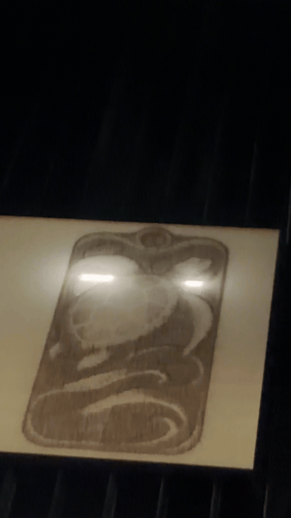
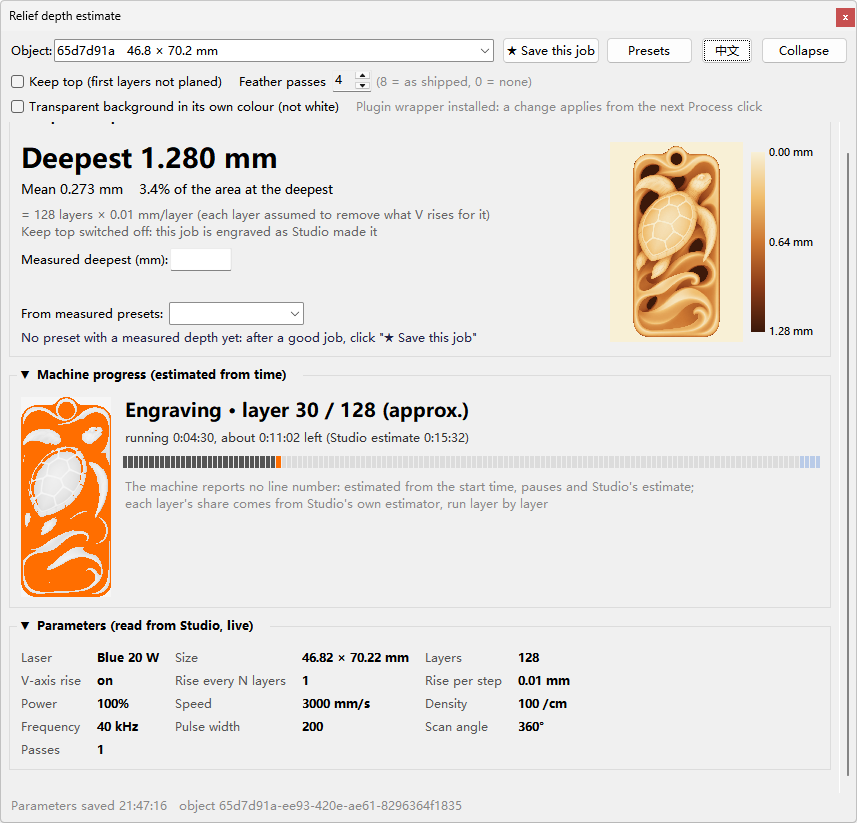

# xTool X1 external components · xTool X1 外置组件

[English](#english) | [中文](#中文)



---

## English

A small wrapper DLL for the relief (3D) mode of xTool Studio on the xTool X1 (JS001). It sits in front of the
vendor path-planning plugin `lib_path_planning.dll`. Right before the vendor slicer runs, it prepares the slicer's
inputs (the grayscale image and `sliceNumber` in `manifest.json`). The vendor slicer then generates the G-code
itself, and the original inputs are put back afterwards. The generated G-code is not edited, with one exception
that you have to ask for: keeping fewer than the slicer's 8 feather passes (see below).

### Disclaimer

- Unofficial. This project is not made, endorsed or supported by xTool. xTool, xTool Studio and X1 are named only
  to say what it works with; the names belong to their owners.
- It changes what Studio sends to the machine: the slicer's input before slicing (keep top, transparent
  background), and the G-code after slicing when you keep fewer than 8 feather passes. A laser can start a fire and
  injure eyes and skin. Run its output only as you would run Studio's own: attended, with the enclosure closed and
  the fume extraction on, and check each job (Studio's preview, the estimator's figures) before you start it.
- With both boxes clear and 8 feather passes the wrapper changes nothing: each call goes straight to the vendor
  plugin. Uninstalling puts the vendor file back.
- Tested only with xTool Studio 1.10.2 beta and one X1 (see Tested, and not verified). The installer refuses other
  builds.
- The estimator's depths, times and layer numbers are estimates, not readings from the machine.
- Installing it replaces a file in Studio's plugin folder. That may affect warranty or support from xTool;
  uninstall it before you ask them for help.
- Provided as is, without warranty of any kind. You use it at your own risk. The authors are not liable for any
  damage to machines, materials, property or people, for spoiled work, or for any other loss that follows from its
  use.

### Switches

| Switch | What it does |
|---|---|
| Keep top | The vendor slicer burns every pixel that is not pure white in its first layer, and almost the whole picture in the next layers, so the top surface gets planed off. With keep-top the first k layers are skipped: the brightest *pct* % of the engraved area (default 5 %) stays at the original surface and everything else is cut from there downward. The gray levels are remapped and `sliceNumber` goes from N to N−k, so the slicer's new layer j burns exactly what its old layer j+k burnt. |
| Transparent background in its own colour | Studio turns transparent pixels white before slicing, and pure white is the untouched top surface in relief mode, so a depth map with a transparent (black) background comes out inverted. The wrapper reads Studio's pre-conversion RGBA copy in the task folder and hands the slicer the colour stored in the transparent pixels. |
| Feather passes (0–8) | When the picture spans more than one galvo block, the slicer appends 8 feather passes after the last relief layer. The count is fixed inside the slicer: 2 rounds of 4 directions 90° apart, in each round 2 passes focused at the original surface and 2 at the engraved bottom. **8** = as shipped. **0** = none: `featherPower` is set to 0 in the input, and the rest of the G-code is byte-identical. **1–7** = only the first n passes: no input asks the slicer for that, so right after it returns, the passes after the first n are cut from the end of `galvo.gc` (whole blocks, up to the `# END` tail) and their elements from `manifest_sliced.json`. 4 = one full round. |

Keep top and transparent background off, feather passes 8 = Studio's own behaviour: the wrapper only forwards the call.

### Slicer behaviour it relies on (measured)

Measured with xTool Studio 1.10.2 beta, plugin build SHA-256
`FD1706D1D3CCACF6C3087E2A29149348AF16A8B3B46D819AB859E25D1AF887B1`, by running the vendor generator and comparing
its own slice images and G-code.

- **Layers.** With N layers and gray g: g = 255 is never burnt; any g ≤ 254 is burnt in layer 0; layer i ≥ 1
  burns g ≤ ⌊256·(N−i)/N⌋. Exact on every layer at N = 64 (photo) and N = 57 (0–255 ramp); checked on the first
  layers at N = 256.
- **White fragments.** Pure-white fragments smaller than roughly 400–800 px, including pieces cut off by block
  borders, are filled and burnt like their surroundings.
- **N ≥ 128.** No gray gives exactly one layer. That target is mapped to 0 (kept at the surface); the deviation
  is at most one layer and is recorded.
- **Missing V line.** Each layer's block grid is shifted by s = max(⌊W/N⌋, 5) + 1 px (W = element width in px).
  Blocks are (int)(blockmm·dpi/25.4) px, with blockmm capped at 30 for the 355nm-5W head. The per-layer
  `G200 V…F600` line is only written at a layer's block (0, 0), which does not exist when the shift is a
  multiple of the block size; that layer and every later one then run one V step too shallow. When choosing k
  the wrapper tries k, k+1…k+3, k−1…k−3 and takes the first N−k that loses no V line (or the fewest).
- **Empty layer start.** When a layer's block (0, 0) has nothing to burn, the slicer still writes it, holding only
  the V line (`G200 V…F600`, `M106 S50`) and no move (54 of 96 layers in one job). Feather passes are therefore
  found from `manifest_sliced.json` and their own start lines, not from how a block begins.
- **Feather passes.** Present only when `featherPower` ≠ 0 and the picture spans more than one block (many more
  when the Cleanup switch `reliefCleanUp` is on). Always 8, in a fixed order: 2 rounds of 4 directions 90° apart;
  in each round passes 1–2 are focused at the original surface and 3–4 at surface + `sliceNumber` / `vLayers` ×
  `vDecline`. No input key changes the count: the panel's Feather Passes value (`alternating_rows`) is only read
  for bitmaps, and 1 or 20 still gave 8. Each pass is one self-contained block with its own focus move and a
  laser-off tail, and the end sequence after `# END` uses absolute moves only, so a file cut after pass n has the
  same shape as the slicer's own files with 0 and 8 passes.

### How it works

```
Studio -> algo-server -> lib_path_planning.dll (wrapper)
                           |  read relief_wrapper.ini
                           |  load relief_fix_core.dll, rf_prepare_task(task folder)
                           |  lib_path_planning_orig.dll: GenJs001ReliefGcodeSync(in, out)   <- vendor, unchanged
                           |  rf_restore_task(task folder): inputs back, feather passes cut if 1-7 asked; unload the core
                           +- return the vendor's return value unchanged
```

- `proxy/` builds `lib_path_planning.dll`. It forwards 173 of the 174 exports to `lib_path_planning_orig.dll`
  (the vendor DLL, renamed) and wraps `GenJs001ReliefGcodeSync(in, out)`. Following the plugin's own function
  description (`algo_get_manifest`): `in = { const char *dir, *dst_gcode, *manifest, *dst_json }`,
  `out = { int32_t code; const char *message, *data }`. The hooks run under an SEH guard; every call is logged
  to `relief_wrapper.log` next to the DLL.
- `core/` builds `relief_fix_core.dll` (`relief_fix.c`, no third-party code):
  - `rf_prepare_task` / `rf_restore_task`: backups as `<file>.rf_orig`, atomic writes, roll-back on any error,
    a report in `relief_fix.json` in the task folder;
  - the feather cut in `rf_restore_task` only runs when this job's prepare finished and asked for it, both files
    are newer than that prepare, the G-code is one file, there are exactly 8 passes and they are the last 8
    blocks before `# END`, the 8 cleaning elements are the last ones and pass i starts with element i's `head` text.
    `manifest_sliced.json` is written first and put back if `galvo.gc` cannot be replaced. If any check fails,
    both files stay as generated and `relief_fix.json` says why;
  - `rf_fix_task`: an output-side variant used for cross-checks.
- The core is loaded for one relief job at a time, so it can be replaced while Studio is running.

### Requirements

- Windows x64.
- xTool Studio with the plugin build above.
- Python 3 for the tools.
- MinGW-w64 gcc to build.

### Build

```
python proxy\gen_def.py "<plugin folder>\lib_path_planning.dll" proxy\lib_path_planning.def
set MINGW_BIN=<MinGW-w64 bin folder>        (or have gcc in PATH)
proxy\build.cmd          -> proxy\lib_path_planning.dll
core\build.cmd           -> core\relief_fix.dll   (install it as relief_fix_core.dll)
```

`gen_def.py` must read the original vendor DLL, so run it before installing. Prebuilt binaries are in `bin/`, with
checksums in `bin/SHA256SUMS.txt`.

### Install and uninstall

Close Studio, then run:

```
powershell -ExecutionPolicy Bypass -File tools\relief_wrapper_ctl.ps1 -Mode 1 [-PluginDir "<...\algo-path-planning-plugin>"]
```

The default `-PluginDir` is
`%LOCALAPPDATA%\Programs\xTool Studio\resources\tools\algo-server\plugins\algo-path-planning-plugin`.

| Mode | Effect |
|---|---|
| `-Mode 1` | Install: the vendor DLL is renamed to `lib_path_planning_orig.dll`, the wrapper and core are copied, `relief_wrapper.ini` is created. Only over the exact vendor build (`-VendorSha`), and only while the plugin is not loaded. |
| `-Mode 0` | Uninstall: the vendor DLL is back under its own name. |
| `-Mode status` | Report the plugin folder state. |
| `-Mode core` | Replace only `relief_fix_core.dll`; Studio may be running. |

`relief_wrapper.ini` in the plugin folder is read on every relief generation:

```
keep_top=5              # percent of the engraved area kept at the surface, 0 = off
feather_passes=8        # feather passes kept, 0-8 (8 = as shipped, 0 = none); wins over keep_feather
keep_feather=1          # for wrapper builds without feather_passes: 1 = keep the passes, 0 = drop them
transparent_as_color=1  # 1 = transparent pixels in their own colour, 0 = as Studio does (white)
```

### Tools



- `tools/relief_estimator.py` is an optional window next to Studio. It reads the relief values Studio stores for
  the selected picture and shows the estimated depth, a depth map and a per-layer table. It also holds the
  switches (two boxes and the number of feather passes; boxes clear and 8 passes = Studio's behaviour) and writes
  `relief_wrapper.ini`. Each box below the switches folds by its title (a one-line summary shows while folded, and
  the window keeps the choice); the window sizes itself to what is open and scrolls when the screen is too short.
  The EN / 中文 button at the top right switches the window between English and Chinese; the
  choice is kept in `%LOCALAPPDATA%\xtool-relief-wrapper\estimator.json` (first start: the Windows UI language,
  or `--lang zh|en`).
  The window belongs to Studio's main window, as Studio's own dialogs do: it stays above Studio but not above
  other programs, hides while Studio is minimised and closes as soon as Studio quits. Collapse (top right) shrinks
  it to one line, the expected depth and, while a job runs, the layer the machine is on and the time left; a click
  on that line or Expand opens it again. The window keeps the choice.
  - **★ Save this job**: after a good result, keeps the job's values (laser, layers, V per layer, power, speed,
    density, frequency, passes, energy per layer, switches, Studio's values) with the material, board thickness,
    measured depth, a note and a photo: the machine's own photo at the end of the job (Studio keeps it under
    `reportData`, used if taken within 2 hours), Studio's camera picture, an image file or a pasted screenshot.
  - **Presets**: the list, filtered by material, with each record's photo and values. For one material and laser,
    the measured µm per layer is fitted against the energy per layer (a line through zero, or a straight line
    from 3 records spread over 20 % in energy). It gives the depth to expect for the current job, and for a target
    depth the layers needed with the current settings or the speed for the current number of layers. The main
    window shows the same estimate under the expected depth.
  - The library is `%LOCALAPPDATA%\xtool-relief-wrapper\presets`: `presets.jsonl` (one record per line),
    `photos\` (JPEG, at most 2000 px) and `thumbs\` (the relief picture).
  - **Live progress**: while the machine runs a relief job, the window shows the layer (or feather pass) it is on,
    that layer's area in colour on the picture (the slicer's own tiles from the task folder) and a bar of all
    layers. The machine reports no line number while it engraves, only ready / start / pause / resume / finish /
    cancel, so the position comes from Studio's logs: the working time since the start (pauses taken out),
    Studio's own time estimate of the G-code it sent (`get_time_from_gcode` in the algo-server log), and each
    layer's share of that time from the same estimator (`js001GetGCodeTimeSync`, type 2) run layer by layer on
    that G-code. On a 128-layer job the shares were within 0.4 % of the estimator's own figures for the file cut
    after layers 16, 32, 64 and 96; sharing by the number of G-code moves instead was off by up to 42 %, because
    the feather passes are many short dot moves. Layers whose V line the slicer drops are numbered from the
    wrapper's record (or the same rule). Each finished job records its real time against Studio's estimate, and
    later jobs use the median of the last ten (per laser). For the estimate the plugin DLL and its runtime are
    copied to `%LOCALAPPDATA%\xtool-relief-wrapper\vendor-dll`; without them the time is shared by G-code moves and
    the window says so.
- `tools/verify/gcode_dialogue.py` and `tools/verify/machine_safety_check.py` compare two `galvo.gc` files:
  - command vocabulary and parameter values;
  - V positions;
  - the laser spot's area on the table;
  - laser-on path per layer;
  - header, camera/defocus block and end sequence;
  - with `--feather N`: the new file keeps the first N of the old file's feather passes, in order.

### Issues found in xTool Studio 1.10.2 beta (X1)

Each item was reproduced with the vendor's own generator unless marked *not tested*.

1. **Relief planes off the original surface.** Layer 0 burns every pixel that is not pure white, and the next
   layers burn almost the whole picture again: on a photo at N = 64, layer 0 covered 99.99 % of the picture and
   layers 1–10 each more than 91 %. The original surface survives only where the picture is pure white, so the
   bright parts of a relief are cut down with everything else. *Wrapper: keep top.*
2. **Transparent pixels are turned white before slicing.** Studio's image conversion (`bitmapCv`) composites
   transparent pixels onto white. A depth map whose background is transparent (stored as black, 22.1 % of the
   picture in one job) reached the slicer with 99.6 % of those pixels at 255. In relief mode pure white is
   the untouched top, so the background stays at the surface and the figure is carved down: the relief is
   inverted. *Wrapper: transparent background in its own colour.*
3. **Missing V lines.** The per-layer focus line `G200 V…F600` is only written at a layer's block (0, 0). When
   the layer's grid shift s·j (s = max(⌊W/N⌋, 5) + 1 px) is a multiple of the block size, that block does not
   exist and the line is skipped; from that layer on every layer runs one `vDecline` too shallow. Examples, same
   1043 px wide picture with the 355nm-5W head (450 px blocks): N = 29 loses layer 25, N = 53 loses 45,
   N = 128 loses 50 and 100, N = 210 loses 75 and 150, N = 256 loses 75, 150 and 225; 135 of the values
   N = 2…256 are affected, and every N ≥ 174. A 399 px wide 455nm-20W job at N = 256 lost layer 250.
   *Wrapper: picks k so that N−k loses no V line, or the fewest.*
4. **Eight extra passes with the Cleanup switch off.** With `reliefCleanUp` false the generator still appends
   8 passes (`isCleaningLayer`) after the last relief layer whenever the picture spans more than one block. Their
   power, speed, frequency and pulse width are fixed (98 %, 138000, 90 kHz, 500 ns); they do not follow the
   panel's feather power and feather speed, which only switch the passes on or off. Their number is fixed too: the
   panel's Feather Passes value (`alternating_rows`, 1–20) is not read for relief, and 1 and 20 both gave 8. In
   one job they were 140.4 MB of a 179.6 MB G-code file (78 %), mostly dot moves.
   *Wrapper: feather passes 0–8 (8 by default).*
5. **Feather passes drive the galvo far outside the field.** On pictures with white areas, their laser-off moves
   at line ends go to galvo coordinates up to A −29…82 mm and B −23…86 mm (up to about 60 mm from the field
   centre at (30, 30); relief moves stay within 0…53 mm). Seen in plain vendor jobs without the wrapper. Whether the X1's galvo can
   physically go that far: *not tested*.
6. **White regions are burnt along block borders.** The filter that fills small white fragments runs per 30 mm
   block, so a large white region cut by a block border leaves small pieces at the border, and those pieces are
   burnt like their surroundings (1,112 pixel-layers on white pixels in one 57-layer job).
7. **The 30 mm block cap of the 355nm-5W head is written into the job-wide block settings**, so in a job with
   several elements it also applies to the elements after it. *Not tested.*
8. **Unbounded memory.** A relief element with `interlaceFillMode` = `"line"` (Studio does not send this key)
   made the generator grow to 18 GB within two minutes.
9. **Long sessions stop generating.** A Studio window that had been open for about 71 hours could no longer
   generate or send jobs (WebAssembly out of memory); restarting Studio fixed it.
10. **Minor inconsistencies.**
    - `estimate_result.json` reports `cleanBytes` 0 while the 8 passes are present (they are counted as `dotBytes`).
    - A camera suspension (`G106` … `G107`, defocus detection) does not return the galvo to where it left it: in
      one job the galvo was at A 45.317 B 15.867 before `G106` and the suspension ends with `G0A45.317B15`. The next
      move is laser-off, so nothing is burnt off position.
    - algo-server's own `manifest.json` lists plugin file sizes that differ from the shipped files (for example
      19,796,760 vs 19,796,752 bytes for `lib_path_planning.dll`).

### Tested, and not verified

Tested against the vendor generator:

- 15 jobs: 8 different pictures at 64 layers; one picture at 64, 96, 128, 200 and 256 layers; a 455nm-20W job
  with 256 layers; a job with a transparent background.
- The generated layers equal the vendor's layers k…N−1 pixel for pixel, apart from the vendor's own fill of white
  fragments.
- Inputs are restored byte for byte.
- G-code checks pass where the vendor's own file has all its V lines: no command or value the vendor's file does
  not use, laser area within the vendor's. Where the vendor's file itself misses V lines, the count of V lines is
  checked instead.
- Feather passes, one job (128 layers, 8 passes, about 122 MB). On one vendor run, the cut for n = 1, 4, 6 and 7
  equals the vendor's file minus its last 8 − n pass blocks, byte for byte, and `manifest_sliced.json` equals the
  vendor's with one range removed that parses as the vendor's minus the last 8 − n elements. Through algo-server
  with the wrapper (keep-top on, and keep-top off): n = 1, 4, 6, 7 keep the vendor's first n passes in order, with
  the relief part byte-identical to the 8-pass run; 0 leaves none; a `relief_wrapper.ini` without `feather_passes`
  keeps all 8. The cut took 0.14–0.34 s. `machine_safety_check.py` passes 29 of 30 checks; the one it flags is the
  vendor's camera suspension (issue 10), the same bytes as in the vendor's file.
- A 96-layer job (197 MB) with 54 empty layer starts: n = 4 and 6 equal the vendor's file minus its last passes,
  byte for byte, and `gcode_dialogue.py` passes. `machine_safety_check.py` reports 4 failures there, and the same 4
  with the same details when the vendor's file is compared with itself: its layer model does not handle empty layer
  starts either.
- 120 synthetic checks: every n; empty layer starts; a second call on the same job cuts nothing more; every case the cut refuses (7
  passes, no passes, a pass that does not start with its element's head, cleaning elements not last, a split job,
  another `.gc` file, output older than the prepare, no `# END`, CRLF, an extra pass signature, a duplicate
  `elements` key, an incomplete record, Cleanup on, a locked `galvo.gc`) leaves both files as generated.
- A wrapper DLL from before `feather_passes` with the new core: the setting is ignored and all 8 passes are kept.

The estimator window, on a separate desktop with a stand-in for Studio's window: it moves to the main window when a
splash window is replaced, hides while that window is minimised or hidden and comes back with it, stays above it but
below another program's window brought to the front, collapses and opens again, and closes within 0.3 s after
Studio quits. Studio's launch window is always on top (its start-up code calls `setAlwaysOnTop`), and Windows puts
the windows it owns on top with it and leaves them so when they then belong to the main window; with a stand-in
launch window that does the same, the estimator takes that off once it belongs to the main window, staying right
above Studio, or below another program in front. With the real Studio (one start, before that fix): owned by its
main window, and left on top by the launch window, which is how this was found.

Not verified:

- The engraved result on different materials.
- Engraving with fewer feather passes: how the seams between blocks look.
- With the real Studio: minimising and closing it, and a start with its launch window since the fix above.
- Other Studio or plugin builds. The installer refuses them; for another build, regenerate the `.def` and rebuild.

### Credits

- Testing: all of it by Eddy.
- Debugging, concept and the redesign of the framework: Eddy. Implementation: Claude.
- In Eddy's own use the fix works well. If you do not need it, leave it off: every switch is optional.

### License

Apache License 2.0, see [LICENSE](LICENSE). Copyright 2026 eddy.

---

## 中文

给 xTool X1（JS001）在 xTool Studio 里的浮雕（3D）模式用的一层包装 DLL，放在厂家路径规划插件
`lib_path_planning.dll` 前面。厂家生成器动手之前，它先把生成器要读的输入准备好：灰度图，以及 `manifest.json`
里的 `sliceNumber`。G 代码仍然由厂家生成器自己算，算完把原输入还原。生成出来的 G 代码不改，只有一个例外，要你自己选：
羽化遍数少于生成器的 8 遍（见下）。

### 免责声明

- 非官方项目。不是 xTool 出的，xTool 没有认可，也不提供支持。文中提到 xTool、xTool Studio、X1，只是说明它配合什么用，
  名称归各自所有者。
- 它会改 Studio 发给机器的内容：切片前改生成器的输入（保留顶部、透明背景），羽化遍数少于 8 遍时还会在切片后改 G 代码。
  激光会引起火灾，会伤眼睛和皮肤。它的输出只能像 Studio 自己的输出一样用：有人看着、机盖关好、排烟开着；每一单开刻前
  都先核对（Studio 的预览、估算窗口的数值）。
- 两个勾都不勾、羽化 8 遍时，包装层什么都不改，每次调用直接交给厂家插件。卸载会把厂家的原文件放回去。
- 只在 xTool Studio 1.10.2 测试版和一台 X1 上测过（见「测过的和没核实的」）。别的版本，安装脚本会拒绝。
- 估算窗口里的深度、时间、层号都是推算的，不是机器报上来的读数。
- 安装时会替换 Studio 插件文件夹里的一个文件，这可能影响 xTool 的保修或售后；找他们售后之前先卸载。
- 按原样提供，不做任何保证，使用风险自负。对机器、材料、财物、人身的任何损害，作品报废，以及使用它引起的其他任何损失，
  作者都不承担责任。

### 开关

| 开关 | 作用 |
|---|---|
| 保留顶部 | 厂家生成器第一层会把所有不是纯白的像素都刻一遍，后面几层也几乎刻满整张图，表面就被刨掉了。打开后跳过前 k 层：要刻的面积里最亮的 *pct* %（默认 5 %）保持原表面，其余从原表面往下刻。做法是重新映射灰度，把 `sliceNumber` 从 N 改成 N−k，让新的第 j 层正好刻原来第 j+k 层的内容。 |
| 透明背景按图里的颜色 | Studio 在切层前把透明像素变成白色，而纯白在浮雕里是不刻的最高面，所以背景透明（存的是黑色）的深度图会刻反。打开后读任务文件夹里 Studio 转换前的 RGBA 原图，把透明像素里存的颜色交给生成器。 |
| 羽化遍数（0–8） | 图跨过不止一个振镜块时，生成器在最后一层后面加 8 遍羽化。遍数是生成器里写死的：2 轮，每轮 4 个方向各转 90°，每轮前 2 遍对焦在原表面、后 2 遍对焦在刻完的底面。**8**＝厂家原样。**0**＝不加：把输入里的 `featherPower` 设成 0，其余 G 代码逐字节不变。**1–7**＝只留前 n 遍：没有哪个输入能让生成器这么做，所以生成器一返回，就把第 n 遍之后的几遍从 `galvo.gc` 末尾剪掉（整块剪，剪到 `# END` 收尾为止），`manifest_sliced.json` 里对应的元素一起去掉。4＝正好一整轮。 |

保留顶部、透明背景都关着，羽化遍数是 8＝Studio 原样，包装层只负责转发。

### 依据的生成器规则（实测）

在 xTool Studio 1.10.2 测试版、插件 SHA-256
`FD1706D1D3CCACF6C3087E2A29149348AF16A8B3B46D819AB859E25D1AF887B1` 上实测：让厂家生成器实际跑，再对它自己的
切层图和 G 代码。

- **分层**：N 层、灰度 g 时，g = 255 任何层都不刻；g ≤ 254 第 0 层刻；第 i ≥ 1 层刻 g ≤ ⌊256·(N−i)/N⌋。
  N = 64（照片）、N = 57（0–255 渐变）时逐层全对；N = 256 核对了前几层。
- **白色碎片**：小于约 400–800 像素的纯白碎片（包括被分块边界切开的碎片）会按周围颜色填上一起刻。
- **N ≥ 128**：调不出「正好刻 1 层」的灰度。这一档改成 0（留在原表面），偏差最多 1 层，记进报告。
- **少写 V 行**：每层分块网格错开 s = max(⌊W/N⌋, 5) + 1 像素（W＝元素宽度像素）；一块是
  (int)(blockmm·dpi/25.4) 像素，355nm-5W 头的 blockmm 封顶 30。每层的 `G200 V…F600` 只写在这一层的 (0, 0)
  块上；错开量正好是块大小的整数倍时，这一块不存在，这一层和之后每层都会浅一个 V 步长。选 k 时包装层依次试
  k、k+1…k+3、k−1…k−3，取第一个不丢 V 行（或丢得最少）的 N−k。
- **空换层块**：某一层的 (0, 0) 块没东西可刻时，生成器照样写这一块，里面只有换焦点那几行（`G200 V…F600`、`M106 S50`），
  没有任何移动（有一单 96 层里有 54 个）。所以找羽化遍要看 `manifest_sliced.json` 和每一遍自己的开头，不能看块是怎么开头的。
- **羽化遍**：只有 `featherPower` ≠ 0 且图跨过不止一块时才有（打开「清理」开关 `reliefCleanUp` 时会多很多）。总是 8 遍，
  顺序固定：2 轮，每轮 4 个方向各转 90°；每轮第 1–2 遍对焦在原表面，第 3–4 遍对焦在原表面 + `sliceNumber` / `vLayers` ×
  `vDecline`。没有哪个输入键能改遍数：面板上的「羽化次数」（`alternating_rows`）只给位图用，填 1 或 20 实测都还是 8 遍。
  每一遍是独立的一块，自己移焦点、块尾关光；`# END` 后面的收尾全是绝对位置，所以剪到第 n 遍的文件，跟生成器自己出的
  0 遍、8 遍文件是同一种形状。

### 工作方式

```
Studio -> algo-server -> lib_path_planning.dll（包装层）
                           |  读 relief_wrapper.ini
                           |  加载 relief_fix_core.dll，rf_prepare_task(任务文件夹)
                           |  lib_path_planning_orig.dll：GenJs001ReliefGcodeSync(in, out)   <- 厂家原函数，不改
                           |  rf_restore_task(任务文件夹)：还原输入，选了 1-7 遍就剪羽化；卸载核心
                           +- 原样返回厂家的返回值
```

- `proxy/` 编出 `lib_path_planning.dll`：174 个导出里 173 个原样转发给 `lib_path_planning_orig.dll`（改名后的
  厂家 DLL），只包住 `GenJs001ReliefGcodeSync(in, out)`。按插件自带的函数说明（`algo_get_manifest`）：
  `in = { const char *dir, *dst_gcode, *manifest, *dst_json }`，`out = { int32_t code; const char *message, *data }`。
  钩子在 SEH 保护里跑；每次调用都记进 DLL 旁边的 `relief_wrapper.log`。
- `core/` 编出 `relief_fix_core.dll`（`relief_fix.c`，没有第三方代码）：
  - `rf_prepare_task` / `rf_restore_task`：备份成 `<文件>.rf_orig`，原子写入，出错回滚，在任务文件夹写报告
    `relief_fix.json`；
  - `rf_restore_task` 里剪羽化，要同时满足：这一单的准备步骤做完了而且要求了，两个文件都比准备步骤新，G 代码没拆成
    多个文件，正好 8 遍、就是 `# END` 前的最后 8 块，8 个清洗元素在最后、第 i 遍以第 i 个元素的 `head` 开头。先写
    `manifest_sliced.json`，`galvo.gc` 换不上就把它退回去。有一条不满足，两个文件都保持生成器原样，`relief_fix.json`
    里写明原因；
  - `rf_fix_task`：输出端做法，用来交叉核对。
- 核心一次只为一单浮雕加载，所以 Studio 开着也能替换。

### 环境

- Windows x64。
- xTool Studio，插件是上面那个版本。
- 工具要 Python 3。
- 编译要 MinGW-w64 gcc。

### 编译

```
python proxy\gen_def.py "<插件目录>\lib_path_planning.dll" proxy\lib_path_planning.def
set MINGW_BIN=<MinGW-w64 的 bin 目录>        （或者 gcc 已在 PATH 里）
proxy\build.cmd          -> proxy\lib_path_planning.dll
core\build.cmd           -> core\relief_fix.dll   （安装时用 relief_fix_core.dll 这个名字）
```

`gen_def.py` 要读厂家原版 DLL，所以在安装之前运行。编好的文件在 `bin/`，校验值在 `bin/SHA256SUMS.txt`。

### 安装和卸载

关掉 Studio，再运行：

```
powershell -ExecutionPolicy Bypass -File tools\relief_wrapper_ctl.ps1 -Mode 1 [-PluginDir "<...\algo-path-planning-plugin>"]
```

`-PluginDir` 默认是
`%LOCALAPPDATA%\Programs\xTool Studio\resources\tools\algo-server\plugins\algo-path-planning-plugin`。

| 模式 | 作用 |
|---|---|
| `-Mode 1` | 安装：厂家 DLL 改名成 `lib_path_planning_orig.dll`，放上包装层和核心，建 `relief_wrapper.ini`。只在厂家 DLL 正好是那个版本（`-VendorSha`）、插件没被占用时才装。 |
| `-Mode 0` | 卸载：厂家 DLL 改回原名。 |
| `-Mode status` | 查看插件目录状态。 |
| `-Mode core` | 只换 `relief_fix_core.dll`，Studio 开着也行。 |

插件目录里的 `relief_wrapper.ini`，每次生成浮雕都会读：

```
keep_top=5              # 要刻面积里保持原表面的百分比，0 = 关
feather_passes=8        # 留几遍羽化，0-8（8 = 厂家原样，0 = 不加）；有这一项就不看 keep_feather
keep_feather=1          # 给没有 feather_passes 的旧版包装层用：1 = 保留羽化遍，0 = 去掉
transparent_as_color=1  # 1 = 透明像素按图里的颜色，0 = 照 Studio（当白色）
```

### 工具


- `tools/relief_estimator.py`：可选的窗口，跟着 Studio 显示。它读 Studio 给所选图片存的浮雕参数，显示预计深度、
  深度图和逐层表；开关也在这里（两个勾和羽化遍数；都不勾、8 遍＝Studio 原样），改了就写入 `relief_wrapper.ini`。
  开关下面的每一块点标题就能折叠（折叠后标题旁显示一行摘要，下次打开保持原样）；窗口按展开的内容自动定高，屏幕不够高时可以滚动。
  右上角「EN / 中文」按钮切换中英文，选择记在 `%LOCALAPPDATA%\xtool-relief-wrapper\estimator.json`（第一次打开按 Windows
  界面语言，也可以用 `--lang zh|en` 指定）。
  窗口挂在 Studio 主窗口下面，跟 Studio 自己的对话框一样：只盖在 Studio 上面，不盖别的程序；Studio 最小化它跟着藏起来，
  Studio 一关它也关。右上角「收起」把它缩成一行：预计最深，机器在刻时再加上刻到第几层、还要多久；点这一行或「展开」恢复。
  收起还是展开，下次打开保持原样。
  - **★ 记录这次**：刻得好就点它，存下这次的参数（光源、层数、V 每层、功率、速度、密度、频率、加工次数、每层能量、开关、
    Studio 的原始参数），加上材料、板厚、实测最深、备注和一张照片：机器完工时自己拍的照片（Studio 存在 `reportData` 里，
    2 小时内拍的才带）、Studio 相机照、图片文件或粘贴的截图。
  - **参数库**：记录列表，可按材料筛选，点一条看照片和全部参数。同一种材料、同一个光源的实测记录，按「每层实刻 µm」对
    「每层能量」拟合（记录少时过零点的直线，3 条以上且能量差 20 % 以上时用一般直线），推算当前任务会刻多深；填目标深度，
    给出参数不变要多少层，或者层数不变速度要调到多少。主窗口预计深度下面也显示同样的推算。
  - 记录存在 `%LOCALAPPDATA%\xtool-relief-wrapper\presets`：`presets.jsonl`（一行一条）、`photos\`（JPEG，最长边不超过
    2000 像素）、`thumbs\`（浮雕图缩略图）。
  - **实时进度**：机器刻浮雕时，窗口显示现在刻到第几层（或羽化第几遍），在浮雕图上用颜色标出这一层要刻的区域（用任务文件夹里
    厂家生成器自己的切片图），下面一条进度条列出所有层。机器加工时不报刻到哪一行，只报准备、开始、暂停、继续、完成、取消，
    所以位置从 Studio 的日志推算：开始以后刻了多久（扣掉暂停）、Studio 对发出去那份 G 代码的预估时间（algo-server 日志里的
    `get_time_from_gcode`），以及用同一个估算函数（`js001GetGCodeTimeSync`，类型 2）对这份 G 代码逐层算出的每层所占时间。
    一单 128 层实测，逐层算出的累计比例，跟把文件截到第 16、32、64、96 层时厂家估算的结果相差都在 0.4 % 以内；改按 G 代码
    指令条数分时间，最多差 42 %，因为羽化遍是大量很短的打点。厂家漏写 V 行的层，按包装层的记录（或同一条规则）编号。每单
    刻完会记下实际用时和 Studio 预估之比，之后按同一光源最近十单的中位数校正。估算时把插件 DLL 和它的运行库复制到
    `%LOCALAPPDATA%\xtool-relief-wrapper\vendor-dll` 再用；用不了就按指令条数粗分，窗口上会写明。
- `tools/verify/gcode_dialogue.py`、`tools/verify/machine_safety_check.py`：对比两份 `galvo.gc`，核对：
  - 指令种类和参数值；
  - V 轴位置；
  - 出光点在台面上的范围；
  - 每层出光路程；
  - 文件头、拍照/离焦检测块和结尾；
  - 加 `--feather N` 时：新文件留的是旧文件的前 N 遍羽化，顺序不变。

### 在 xTool Studio 1.10.2 测试版（X1）里发现的问题

除了标「未实测」的，每一条都用厂家自己的生成器复现过。

1. **浮雕把原表面刨掉。** 第 0 层刻所有不是纯白的像素，后面几层又几乎把整张图刻一遍：一张照片按 64 层，第 0 层刻了
   99.99 % 的面积，第 1–10 层每层都超过 91 %。只有纯白的地方能留住原表面，浮雕最亮的部分也跟着一起被刻下去。
   *包装层：保留顶部。*
2. **切层前把透明像素变成白色。** Studio 的图像转换（`bitmapCv`）把透明像素合成到白底上。一张背景透明（存的是黑色，
   这一单占 22.1 %）的深度图，交到生成器手里时这些像素有 99.6 % 变成了 255。浮雕里纯白是不刻的最高面，于是背景留在表面、
   人物往下刻，整个浮雕反了。*包装层：透明背景按图里的颜色。*
3. **少写 V 行。** 每层的焦点行 `G200 V…F600` 只写在这一层的 (0, 0) 块上。这一层的网格错开量 s·j（s = max(⌊W/N⌋, 5) + 1
   像素）正好是块大小的整数倍时，这一块不存在，这一行就没了；从这一层起，后面每层都浅一个 `vDecline`。例子：同一张
   1043 像素宽的图、355nm-5W 头（450 像素一块），N = 29 丢第 25 层，N = 53 丢第 45 层，N = 128 丢第 50、100 层，
   N = 210 丢第 75、150 层，N = 256 丢第 75、150、225 层；N = 2…256 里有 135 个取值中招，N ≥ 174 全部中招。一单
   399 像素宽的 455nm-20W、256 层，丢了第 250 层。*包装层：选 k 时让 N−k 不丢 V 行，避不开就丢得最少。*
4. **「清理」关着也加 8 遍。** `reliefCleanUp` 是 false 时，只要图跨过不止一块，生成器照样在最后一层后面加 8 遍
   （`isCleaningLayer`）。这 8 遍的功率、速度、频率、脉宽是写死的（98 %、138000、90 kHz、500 ns），不跟面板上的羽化
   功率、羽化速度走，面板那两项只起开关作用。遍数也是写死的：面板上的「羽化次数」（`alternating_rows`，1–20）浮雕不读，
   填 1 或 20 都还是 8 遍。有一单它们占了 179.6 MB G 代码里的 140.4 MB（78 %），大部分是打点。
   *包装层：羽化遍数 0–8（默认 8）。*
5. **羽化遍把振镜打到视场外很远。** 图里有白色区域时，这几遍在行尾的关光移动会把振镜坐标打到 A −29…82 mm、
   B −23…86 mm（离视场中心 (30, 30) 最远约 60 mm；浮雕本身的移动在 0…53 mm 以内）。不装包装层、厂家原样生成的任务里就有。X1 的振镜
   物理上能不能偏这么远：*未实测*。
6. **白色区域沿分块边界被刻。** 填掉白色小碎片的那一步是按 30 mm 一块做的，大白块被块边界切开，边上剩下的小碎片就按
   周围颜色刻掉（一单 57 层里，白色像素上多刻了 1,112 个像素·层）。
7. **355nm-5W 头的 30 mm 分块上限被写进整单共用的分块设置**，一单有多个元素时，后面的元素也跟着被限。*未实测。*
8. **内存不设上限。** 浮雕元素里写 `interlaceFillMode` = `"line"`（Studio 不会发这个键）时，生成器两分钟内涨到 18 GB。
9. **开久了就生成不了。** 一个开了约 71 小时的 Studio 窗口，生成、发送任务都失败（WebAssembly 内存不足），重启
   Studio 才恢复。
10. **小的不一致。**
    - `estimate_result.json` 里 `cleanBytes` 是 0，可那 8 遍明明在（被算进了 `dotBytes`）。
    - 拍照暂停（`G106` … `G107`，离焦检测）结束时，振镜没回到暂停前的位置：有一单暂停前振镜在 A 45.317 B 15.867，暂停
      最后一行却是 `G0A45.317B15`。下一步是关光移动，所以不会刻歪。
    - algo-server 自己的 `manifest.json` 记的插件大小跟实际文件对不上（比如 `lib_path_planning.dll` 记 19,796,760，
      实际 19,796,752 字节）。

### 测过的和没核实的

在厂家生成器上测过：

- 15 单：8 张不同的图（64 层）；同一张图 64、96、128、200、256 层；一单 455nm-20W 的 256 层；一单透明背景的图。
- 生成器切出的每一层，跟厂家原来第 k…N−1 层逐像素一致；只有厂家自己填白色碎片的地方不同。
- 输入逐字节还原。
- 厂家原文件 V 行齐全的那几单，G 代码核对全过：没有厂家文件里没用过的指令或数值，出光范围在厂家原范围内。厂家原文件
  自己就丢 V 行的那几单，改为核对 V 行条数。
- 羽化遍数，一单（128 层、8 遍、约 122 MB）：在厂家同一次生成的结果上剪 n = 1、4、6、7 遍，`galvo.gc` 跟厂家文件去掉
  最后 8 − n 遍的整块逐字节相同；`manifest_sliced.json` 是厂家文件删掉一整段，解析出来正好是去掉最后 8 − n 个元素。
  经 algo-server 和包装层整条跑（保留顶部开、关都测）：n = 1、4、6、7 留下厂家的前 n 遍、顺序不变，浮雕部分跟 8 遍那单
  逐字节相同；0 一遍不剩；`relief_wrapper.ini` 里没有 `feather_passes` 时 8 遍全留。剪一次 0.14–0.34 秒。
  `machine_safety_check.py` 30 项过 29 项，不过的那一项是厂家自己的拍照暂停（问题第 10 条），跟厂家文件里的字节一样。
- 一单 96 层（197 MB）、有 54 个空换层块：剪 4 遍、6 遍都跟厂家文件去掉最后几遍逐字节相同，`gcode_dialogue.py` 全过。
  `machine_safety_check.py` 在这单上报 4 项不过，拿厂家文件跟它自己比也报同样 4 项、细节一样：它的分层模型同样读不懂空换层块。
- 合成测试 120 项：每个 n；空换层块；同一单再调一次不会再剪；每种该拒绝的情况（只有 7 遍、没有羽化、某一遍开头跟元素的 head
  对不上、清洗元素不在最后、拆成多个文件、多出别的 `.gc`、输出比准备步骤旧、没有 `# END`、CRLF、多一个羽化标记、
  `elements` 键重复、记录不完整、「清理」开着、`galvo.gc` 被占用）两个文件都保持生成器原样。
- 不带 `feather_passes` 的旧版包装 DLL 配新核心：这项设置被忽略，8 遍全留。

估算窗口在一个单独的桌面上、拿一个替身窗口当 Studio 测过：替身的启动画面换成主窗口时，它跟着挂到主窗口上；替身最小化
或藏起来时它跟着藏，回来时跟着出来；替身提到最前时它在替身上面，别的程序窗口提到最前时它在那个窗口下面；收起、展开；
替身一关，0.3 秒内它也关掉。Studio 启动时的加载窗口是置顶的（启动代码里调用了 `setAlwaysOnTop`），Windows 会把挂在它下面的
窗口一起置顶；之后这些窗口改挂到主窗口上，置顶也不会去掉。拿一个同样会置顶的替身加载窗口测过：估算窗口改挂到主窗口以后，
会自己去掉置顶，仍然在 Studio 上面一层；别的程序在最前面时，就在那个程序下面。在真的 Studio 上开过一次（在这次修复之前）：
估算窗口挂在了 Studio 主窗口上，但被加载窗口留下了置顶，这个问题就是这样发现的。

没核实：

- 不同材料上实际刻出来的效果。
- 少刻几遍羽化以后，块与块之间的接缝实际刻出来是什么样。
- 在真的 Studio 上：最小化、关掉 Studio 时估算窗口的表现；以及上面那个修复以后，再带着加载窗口启动一次的表现。
- 别的 Studio 或插件版本。安装脚本会拒绝；换版本要重新生成 `.def` 再编译。

### 说明

- 测试：全程由 Eddy 测试。
- 调试、构思、改造框架：Eddy；执行实现：Claude。
- 修复效果 Eddy 个人感觉良好；不需要的话就不开，每个开关都是可选的。

### 许可证

Apache License 2.0，全文见 [LICENSE](LICENSE)。Copyright 2026 eddy。
